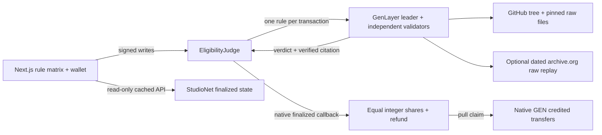

# Eligibility Judge

Open hackathon judging: every entry gets a rule-by-rule verdict anyone can verify.

Organizers publish 3–6 objectively checkable rules and fund a StudioNet GEN pool. Builders submit a public GitHub repository pinned to a full commit SHA. GenLayer validators independently fetch bounded evidence, judge one rule per transaction, and confirm the leader's file path and verbatim quote. Every entry that passes every rule qualifies. Contract code splits the pool equally; the organizer receives the remainder. There is no scoring, ranking, bidding, or organizer-selected winner.

## Architecture



## Local setup

Requires Node.js 20.9+ and Python 3.12+. The Windows development environment uses Python 3.14. Never put a private key in the app or browser bundle.

```sh
npm ci
python -m pip install -r requirements.txt
npm run dev
```

Open http://localhost:3111. The preserved proof snapshot opens without a wallet. Live chain reads come from `/api/chain`, which always requests `LATEST_FINAL`. A browser wallet signs writes on StudioNet 61999. The browser persists transaction hashes and resumes 5-second polling after reload; accepted results stay provisional until finality and callback completion.

## Contract deployment instructions

The runner is pinned to `py-genlayer:1jb45aa8ynh2a9c9xn3b7qqh8sm5q93hwfp7jqmwsfhh8jpz09h6`. Release dependencies pin `genlayer-py==0.18.0` and `genlayer-js==1.1.8`.

```sh
genlayer network set studionet
genlayer account list
genvm-lint check contracts/eligibility_judge.py
python -m pytest tests/direct -q
```

On Windows, use the staged, resumable deployment script with your already unlocked GenLayer CLI account:

The committed manifest resumes the existing public demonstration. For a fresh contract, first preserve that manifest and copy the empty template. This starts a separate instance; its `seed` step deposits another 3 StudioNet GEN from your selected CLI account.

```powershell
Copy-Item -LiteralPath deploy/proof.json -Destination deploy/proof.previous.json
Copy-Item -LiteralPath deploy/proof.template.json -Destination deploy/proof.json
```

```powershell
powershell -ExecutionPolicy Bypass -File scripts/deploy.ps1 probe
powershell -ExecutionPolicy Bypass -File scripts/deploy.ps1 deploy
powershell -ExecutionPolicy Bypass -File scripts/deploy.ps1 seed
powershell -ExecutionPolicy Bypass -File scripts/deploy.ps1 entries
powershell -ExecutionPolicy Bypass -File scripts/deploy.ps1 judge
powershell -ExecutionPolicy Bypass -File scripts/deploy.ps1 settle
npm run verify:proof
```

Each stage records hashes before waiting. Resume the same stage after a timeout; it reuses saved transactions. Receipt reads retry up to five consecutive transient connection or invalid-JSON failures; consensus rejection and uncredited transfers still stop the stage. The `probe` stage deploys its access-probe contract when the fresh manifest has no saved deployment. The demo entrants' test-wallet keys are generated into a gitignored `.env.demo-wallets.json` solely for StudioNet. By default, `seed` funds 3 GEN, starts a twenty-minute window, and validates four rules. Set `ELIGIBILITY_DEMO_WEI=1` to use a 1-wei development demonstration instead. Publish this repository before entering its pinned source commit. The CLI polls every ten seconds to leave headroom below the hourly RPC budget. Deployment scripts save receipts locally; `deploy/proof.json` is the public, compact manifest. Vercel deploys with a remote build: `vercel --prod --scope wattxs-projects`.

## Verification

```sh
npm run typecheck
npm run build
npm test
genvm-lint check contracts/eligibility_judge.py
python -m pytest tests/direct -q
npm run verify:proof
```

Direct tests mock web and LLM responses and do not claim validator consensus. The read-only proof verifier checks finalized execution, emitted callbacks, observed contract state, exact payout credit, and deployed source. Browser verification is recorded separately in `docs/browser-verification.json`. Native Studio appeals use the actual `sim_getFinalityWindowTime` and receipt timestamps, including processing time and failed appeals. The native failed-appeal reduction defaults to Studio’s 0.2 and can be matched to a changed deployment with the server-only `STUDIONET_APPEAL_FAILED_REDUCTION`. The browser submits the native zero-value Studio appeal and resumes polling the same transaction ID, preserving the wallet-returned receipt hash. EIP-6963 discovery presents an explicit wallet selector, including MetaMask, when several wallet extensions are installed; legacy injection is used only when discovery finds none. These behaviors follow the [official Studio transaction view](https://github.com/genlayerlabs/genlayer-studio/blob/main/frontend/src/components/Simulator/TransactionItem.vue) and [SDK appeal implementation](https://github.com/genlayerlabs/genlayer-js/blob/main/src/contracts/actions.ts).

## Proof and submission

- [Public proof manifest](deploy/proof.json): addresses, pinned source commit, transaction hashes, four outcomes, grace settlement, exact credited transfers, and completion flags.
- [Fixed contract on StudioNet](https://explorer-studio.genlayer.com/address/0x03E7970E791d644B2714a457D178Edf036670bb7).
- [Tutorial](docs/TUTORIAL.md), [two-minute demo](docs/DEMO.md), and [portal fields](docs/submission/portal-fields.json).
- [Official finality documentation](https://docs.genlayer.com/understand-genlayer-protocol/core-concepts/optimistic-democracy/finality).

The latest contract verifies full source quotes before capping stored excerpts at 600 characters. It also repairs file-presence citations only when the complete metadata matches an independently fetched GitHub tree node, storing the actual verbatim path in `__TREE__`. Failures citing a truncated file become insufficient evidence; positive evidence in its fetched prefix can still pass. Fabricated metadata, hidden suffixes and judge-directed instructions remain rejected.

The [previous paid release](deploy/previous-runs/pre-grace/proof.json) passed 33 direct tests. Six zero-value full-consensus checks finalized with validator agreement: the fixture test file, the truncated README, the SDK test file and license, its bounded Python-contract inspection, and a fully inspected control repository. The SDK inspection correctly remained insufficient; the small control conclusively failed the Python-contract rule. The control is a separate pinned branch of the approved public fixture, preserving its injection case. [Their manifest](deploy/consensus-smoke-proof.json) can be independently rechecked with `npm run verify:smoke`. These tests verify adjudication and exact deployed probe source; they do not prove funding, settlement or payout. The previous one-wei demo had all sixteen finalized rule verdicts: the honest entry qualified, the control and injection entries were disqualified, and the nonexistent commit produced insufficient evidence. Settlement finalized and the qualifier claimed exactly one wei through a credited native transfer. The manifest preserves both real browser judgments. Browser reload recovery passed. A real Chrome / MetaMask native appeal was signed inside the 30-second window and finalized after a second consensus round, upholding the expected rollback of a call against the settled rulebook. This zero-value negative test left the paid demo unchanged. `npm run verify:appeal` checks its on-chain history and exact rollback reason; [native proof](deploy/native-appeal-proof.json) and the separate [archived browser verification report](deploy/previous-runs/pre-grace/browser-verification.json) preserve the historical evidence and wallet-signing limits. These native appeals were verified on the previous contract, not presented as new-contract wallet signatures.

Funding history is preserved: 3 StudioNet GEN are unrecoverable at the first contract after an invalid-window rollback; another 3 GEN remain locked at the second contract because a test-file judgment failed citation verification. One wei remains locked in [the evidence-corrected run](deploy/evidence-run.json), and another in [the citation-bound run](deploy/citation-run.json), which finalized thirteen of sixteen rule verdicts. [Its exact deployed source](deploy/citation-run-contract.py) is archived. The diagnostic exposed a reconstructed tree JSON object attributed to a test file ([raw diagnostic](deploy/fixture-diagnostic-proof.json)). No additional deposit was made during the earlier unfunded citation investigation. On October 7, the owner authorized the fresh one-wei demo; total deposits across attempts at that time were 6 StudioNet GEN plus 3 wei. Nothing is submitted to the Portal automatically.

## Grace settlement correction

The fixed contract is deployed at [0x03E7970E791d644B2714a457D178Edf036670bb7](https://explorer-studio.genlayer.com/address/0x03E7970E791d644B2714a457D178Edf036670bb7). Forty-six contract tests, GenVM lint, TypeScript, sixteen app tests and a production build pass. Both live funded proofs pass independent verification of all 62 receipts, exact deployed source and zero remaining balance. Production Chrome verification passes on desktop and at 390 x 844 for both the paid demo and timeout refund. The release is submission-ready; the owner submits the prepared Portal fields. The earlier paid demo and native appeal evidence are preserved under [previous runs](deploy/previous-runs/pre-grace/proof.json).

Unfinished entries previously prevented settlement forever. The grace correction permits settlement one hour after close, marks unfinished entries insufficient with a timeout reason, rejects new judgments from the deadline, and ignores late callbacks after settlement begins. Final entries still settle immediately at close. This does not unlock pools in already-deployed immutable contracts. Optional demo URLs must be raw Wayback replays: https://web.archive.org/web/20260101000000id_/https://example.com/; the toolbar form is rejected by both the contract and entry form. Judging prompts and validator comparison logic are unchanged.

The earlier locked runs exposed the settlement lock; the grace fix is proven by a separate never-judged entry and an exact credited organizer refund in the [live timeout-path proof](docs/submission/READINESS.md#timeout-path). The real grace settlement finalized after the one-hour deadline; the entry remained without fabricated verdicts. The earlier total of 6 GEN plus 3 wei includes two locked wei and one paid wei. On October 8 the owner approved two additional 1-wei deposits for the payout and timeout-refund proofs. Both new wei were recovered through a credited qualifier payout and organizer refund. Gross deposits across attempts total 6 StudioNet GEN plus 5 wei; the new contract has zero balance.

The resumable timeout stages are timeout-seed, timeout-entry, and timeout-settle. They create a fifteen-minute window with three objective rules, enter a pinned commit without judging it, then require the real close-plus-3600-second deadline before settlement and refund. Approval fields in the staging manifest guard both deposits; saved hashes are always reused after a timeout. The completed proof verifier requires both the standard payout and the live timeout refund.


## Milestone v1: Seasons, Badges and Disputes

The clean `milestone-v1-release` demonstration independently verifies **PASS**, with no reported failures or mismatches. Dispute A overturns the rescued entrant's bounded-evidence payout ruling to PASS. B upholds the control's correct FAIL and pays the frivolous dispute bond to the entrant. C rejects the exact injection argument in a real hearing. Four finalized badges include one `via_dispute` credential; steady and rescued each qualify twice and receive a verified **0.025 GEN** season bonus. The original judge pool remains settled independently.

The immutable judge remains [0x03E7970E791d644B2714a457D178Edf036670bb7](https://explorer-studio.genlayer.com/address/0x03E7970E791d644B2714a457D178Edf036670bb7). The three corrected milestone contracts are reused unchanged, with byte-identical deployed, working and Git sources and verified dependency wiring. Every address is a separate GenLayer Explorer Contract evidence entry:

| Contract | StudioNet Explorer |
| --- | --- |
| RulingDisputes | [0x464f3e7147d1C7e7EdeF5e4A0fcb9393a8F8A680](https://explorer-studio.genlayer.com/address/0x464f3e7147d1C7e7EdeF5e4A0fcb9393a8F8A680) |
| QualificationBadges | [0x0F278ea98EB792C616947Be2Fb4A857C1Be59543](https://explorer-studio.genlayer.com/address/0x0F278ea98EB792C616947Be2Fb4A857C1Be59543) |
| EligibilitySeries | [0x0e355b80258869F6b42016185EBc0901F87C152C](https://explorer-studio.genlayer.com/address/0x0e355b80258869F6b42016185EBc0901F87C152C) |

Repository trees were saved before deposits, complete and below 80,000 bytes. The two rounds use distinct immutable pins. New demo deposits are **80000000000000002 wei** (0.08 GEN plus 2 wei); cumulative gross deposits under this authorization are **130000000000000005 wei** (0.13 GEN plus 5 wei), below the 0.2-GEN ceiling. Previous deposits remain counted after recovery. All three milestone contracts and the original judge have zero balance; the previous attempt's one-wei pool was recovered separately without another deposit.

Validation: 116 direct contract tests and 22 app tests; lint, TypeScript and production build pass. Fresh completed-snapshot checks: **PASS**; desktop and 390x844 browser checks: **PASS**; production release: **PASS**. See [readiness](docs/submission/MILESTONE-V1-READINESS.md), [Portal fields](docs/submission/milestone-v1.json), [the manifest](deploy/milestone-proof.json), [strict verification](deploy/milestone-verification.json) and [the tutorial](docs/TUTORIAL-MILESTONE-V1.md).

The demonstration uses owner-operated wallets and repositories; overturns affect credentials and seasons, not the original judge pool. StudioNet GEN is development currency. The Portal remains for the owner to submit.

### Previous clean run: stopped and recovered

The [exact archive](deploy/previous-runs/milestone-v1-clean-stopped/archive.json) preserves the second-round control judgment that finalized MAJORITY_DISAGREE. Its [separate recovery](deploy/previous-runs/milestone-v1-clean-stopped/docs/submission/MILESTONE-V1-RECOVERY.md) credited all 0.05 GEN plus 2 wei with zero new deposits. This failed demo was not reclassified as passing; its cases are not replayed. The contracts remain valid and are reused by the newly authorized final run.

### Previous final attempt: missing verbatim quote

The [archived attempt](deploy/previous-runs/milestone-v1-final-stopped/archive.json) stopped at a control README judgment with `[LLM_ERROR] quote missing from fetched file` and MAJORITY_DISAGREE. It deposited only 1 wei; no hearings or bonus were funded. Rescued's original payout verdict explicitly identified the truncated source excerpt. The replacement uses a concise unwrapped README and short non-paying claim statement; C supplies its malicious argument only at the hearing. The original failed transaction is never replayed.

### Retired milestone deployments (first run)

The archived [first-run manifest](deploy/previous-runs/milestone-v1-first-run/deploy/milestone-proof.json), [verification](deploy/previous-runs/milestone-v1-first-run/deploy/milestone-verification.json), sources and reports retain every original hash, failure and payout. [Archive checksums](deploy/previous-runs/milestone-v1-first-run/archive.json) preserve their exact bytes.


The milestone extends the existing judge with three contracts. The original judge at `0x03E7970E791d644B2714a457D178Edf036670bb7` remains unchanged; new contracts read its finalized state and never write to it.

| Contract | StudioNet Explorer | Purpose |
| --- | --- | --- |
| RulingDisputes | [0x1fcF18ef9e74159900E4C7eA00F859F9132EBa5C](https://explorer-studio.genlayer.com/address/0x1fcF18ef9e74159900E4C7eA00F859F9132EBa5C) | Bonded, full-file second hearings with verified citations and timed refunds. |
| QualificationBadges | [0x7BCF4C1ED69F0B0dC36b590911f886bd32f24bDE](https://explorer-studio.genlayer.com/address/0x7BCF4C1ED69F0B0dC36b590911f886bd32f24bDE) | Non-transferable credentials after every relevant hearing is final. |
| EligibilitySeries | [0x03262D836d327d4b01103A2ca759BC0776414E53](https://explorer-studio.genlayer.com/address/0x03262D836d327d4b01103A2ca759BC0776414E53) | Fixed-threshold seasons, equal bonus shares, refunds and verified native claims. |

Open [Seasons](https://eligibility-judge.vercel.app/series), [Qualification badges](https://eligibility-judge.vercel.app/badges), or [Rule hearings](https://eligibility-judge.vercel.app/disputes). The original entry matrix also provides a file picker, bonded dispute form, timeline, and original/effective verdict comparison. Reads request `LATEST_FINAL`; saved transaction hashes survive reloads. [The milestone tutorial](deploy/previous-runs/milestone-v1-first-run/docs/TUTORIAL-MILESTONE-V1.md) explains the controls and exit paths.

A hearing independently fetches the **full named file**, up to 64 KB, at the original pinned commit. Validators compare only verdict and path, then verify the leader's quote in their own fetch. Arguments and file instructions are untrusted evidence. UPHELD assigns the bond to the entrant, or organizer for a self-dispute; OVERTURNED refunds it. Unreachable sources or an unresolved 24-hour deadline produce VOID and refund. The payable opening persists its funded reservation before a zero-value file-check callback, so a failed check cannot erase the refund record.

**Overturns change credentials and season standings, never the original judge prize pool.** Badge minting and round imports wait until the dispute-opening window closes and every pending hearing has finalized. Badges carry the pinned repository and commit, rulebook hash and effective-verdict digest. Void rounds do not lower the original qualification count. A season's unavailable sources have a full-refund exit 24 hours after its end. New-contract payments reserve numbered attempts and become paid only after the exact native credit is independently verified; a failed transfer can be retried when funds return.

The live demonstration uses owner-operated public Bullseye and Eligibility Judge repositories, owner-controlled wallets and an existing public negative-test fixture. StudioNet GEN is simulated development currency. The planned consistent qualifier's pinned Bullseye tree is 263,265 bytes, exceeding the immutable judge's 96,000-byte bound; those original insufficient-evidence outcomes are retained. Six additional targeted hearings were planned but were not opened before their windows closed after case C halted the live stage. No failed case was replayed. One original payout-rule transaction finalized with validator disagreement and is preserved without rerun; the immutable judge's one-hour timeout permits settlement. Original pool refunds, rather than fabricated qualifier payouts, remain part of the proof. The first three milestone deployments were replaced **before** any bond or bonus funding, and remain disclosed in the manifest.

The [milestone manifest](deploy/previous-runs/milestone-v1-first-run/deploy/milestone-proof.json) journals deposits, hashes, outcomes and deviations. `npm run verify:milestone` is read-only and generates [independent verification](deploy/previous-runs/milestone-v1-first-run/deploy/milestone-verification.json) after completion. Reported failed original-judge cases are checked as failures and never counted as successful receipts. The milestone deposit ceiling is **1 GEN**; the completed sequence uses **0.13 GEN plus 3 wei** (three 0.01-GEN bonds, a 0.1-GEN season pool, two 1-wei judge pools and a separate 1-wei payout-control season). This budget is separate from the original release's historical funding.

Contract and app checks now comprise 97 direct tests (46 existing + 51 milestone), 22 app tests, lint and SDK validation for all three contracts, TypeScript and production build. Direct tests use mocked evidence and do not prove live consensus. [Portal fields](deploy/previous-runs/milestone-v1-first-run/docs/submission/milestone-v1.json) are ready for owner review with the explicitly reported live deviations; see the [milestone readiness report](deploy/previous-runs/milestone-v1-first-run/docs/submission/MILESTONE-V1-READINESS.md). The original threshold-two season has no winner and refunds its organizer. A separate season with threshold one from creation uses the same finalized rounds to prove a 1-wei bonus credit; it never changes the original threshold. Case C became VOID during its source check, so its later hearing call correctly rolled back and its bond is refundable. This does not prove injection resistance in live consensus; that behavior is covered by direct tests. Each deployed contract, including the unchanged judge dependency, has a separate GenLayer Explorer Contract evidence entry. Nothing is submitted to the Portal automatically.


The completed milestone verifier checks 126 saved hashes and returns `PASS_WITH_REPORTED_FAILURES`: two failed calls remain explicit. All three current contracts have zero balance and byte-identical deployed/Git source; the retired unfunded candidates also have zero balance. The production browser/API report passes, all 33 Explorer links are verified, and a completed-run resume check adds no transactions or deposits. Live injection resistance remains unproven because case C became VOID before its hearing.
